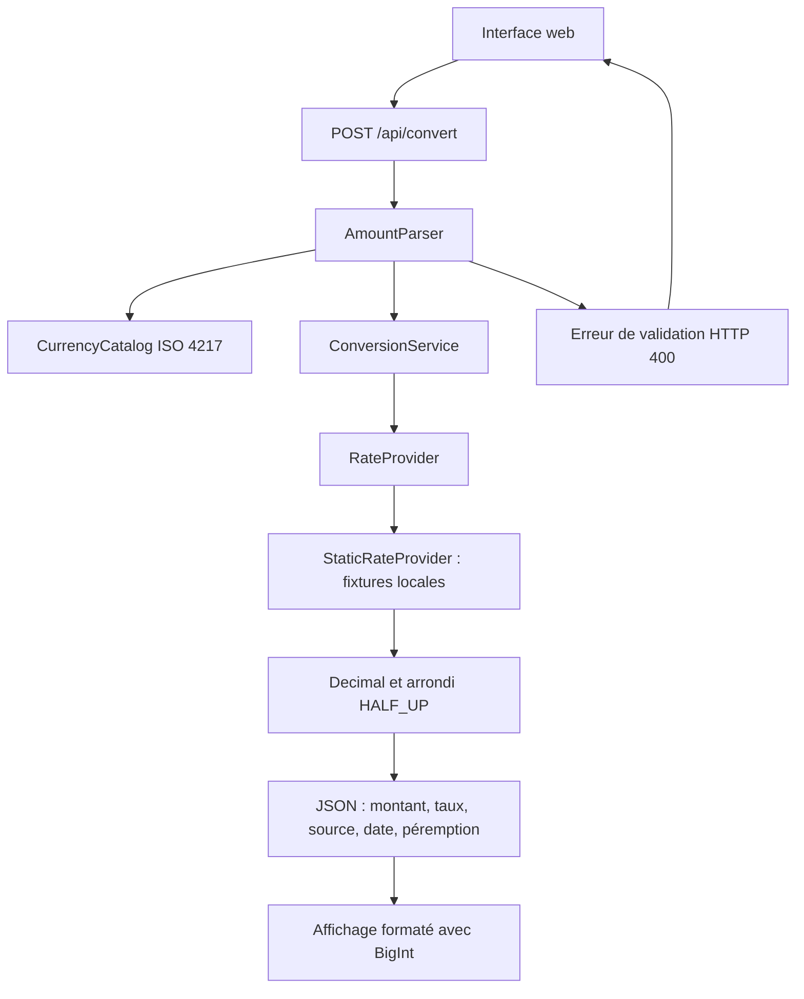

# Cambio

[](https://github.com/nandria-IGN/cambio/actions/workflows/ci-cd.yml)

Convertisseur de devises web en **Python orienté objet**, avec Flask, une interface responsive et une API JSON.

> Les taux intégrés sont des **données de démonstration statiques**, et non des taux de marché. Les conversions sont indicatives : elles ne garantissent aucun taux pour une transaction.

## Démarrage

Prérequis : Python et pip. Python **3.11 à 3.13** est utilisé dans la CI. Aucun besoin de Node.js ou npm.

### Windows / PowerShell

```powershell
git clone https://github.com/nandria-IGN/cambio.git
cd cambio
python -m venv .venv
.\.venv\Scripts\python.exe -m pip install -r requirements.txt
.\.venv\Scripts\python.exe app.py
```

### Linux / macOS

```bash
git clone https://github.com/nandria-IGN/cambio.git
cd cambio
python3 -m venv .venv
.venv/bin/python -m pip install -r requirements.txt
.venv/bin/python app.py
```

Ouvrir **http://127.0.0.1:5000/**. Arrêter le serveur avec `Ctrl+C`.

Le serveur lancé par `app.py` est destiné au développement local. Pour la production, utiliser le conteneur Gunicorn décrit ci-dessous.

## Utilisation

- Saisir un montant, puis choisir la devise source et la devise cible : le résultat se recalcule automatiquement.
- Utiliser le bouton d'inversion pour échanger les devises ; le montant saisi reste inchangé.
- Consulter le taux, sa source et sa date UTC sous les champs.
- Une conversion vers la même devise conserve exactement le montant, avec un taux égal à `1`.

Le calcul et le catalogue n'utilisent aucun fournisseur externe : l'application fonctionne sans accès Internet une fois installée, tant que le serveur Python local est lancé. Le navigateur communique avec ce serveur ; il ne s'agit pas d'une application autonome installée dans le navigateur.

## Règles monétaires

Le catalogue embarqué est un **sous-ensemble ISO 4217**, pas un catalogue exhaustif. Il associe code alphabétique, code numérique conservé comme chaîne, nombre de décimales et statut.

| Devise | Code alphabétique | Code numérique | Décimales |
| --- | --- | --- | --- |
| Yen japonais | JPY | 392 | 0 |
| Euro | EUR | 978 | 2 |
| Dinar koweïtien | KWD | 414 | 3 |
| Unité de compte chilienne | CLF | 990 | 4 |

Devises actives prises en charge : `AUD`, `BHD`, `CAD`, `CHF`, `CLF`, `CNY`, `EUR`, `GBP`, `JPY`, `KWD`, `USD`. Le code retiré `DEM` est présent dans le catalogue pour illustrer son rejet ; il n'est pas proposé dans les sélecteurs.

- Les montants sont stockés en unités mineures entières : `12,34 EUR` devient `1234`, et `1,250 KWD` devient `1250`.
- Les taux sont des chaînes décimales, puis calculés avec `Decimal` dans un contexte de **60 chiffres significatifs**, sans calcul monétaire en `float`.
- Les taux croisés utilisent EUR comme pivot : taux cible divisé par taux source.
- Le résultat est arrondi une seule fois à l'unité mineure cible avec `ROUND_HALF_UP`.
- Le taux retourné pour affichage est arrondi à **8 décimales** ; le calcul du montant utilise le taux à la précision interne, pas ce taux d'affichage.
- Le navigateur reçoit les unités mineures comme chaînes JSON et les formate avec `BigInt`, sans perte liée à la taille des entiers JavaScript.
- La date des fixtures est fixe : **13 octobre 2026 à 08:00 UTC**. Un avertissement apparaît quand leur âge dépasse **24 heures** ; elles ne sont pas actualisées automatiquement.

### Exemples avec les fixtures

| Conversion | Résultat |
| --- | --- |
| 1500 JPY → EUR | 9,24 EUR |
| 12,34 EUR → KWD | 4,131 KWD |
| 1,250 KWD → JPY | 606 JPY |

### Validation et erreurs

| Situation | Comportement |
| --- | --- |
| Montant nul | Accepté, résultat nul dans la devise cible |
| Champ vide | Aucun calcul ; invitation à saisir un montant |
| Saisie terminant par `,` ou `.` | L'interface attend la fin de la saisie |
| Montant négatif | « Les montants négatifs ne sont pas pris en charge. » |
| Format invalide | « Montant invalide. » |
| Trop de décimales pour la source | Rejet avec le nombre de décimales autorisé |
| Montant supérieur à `1 000 000 000 000 000` unités majeures | « Montant trop élevé. » |
| Code inconnu, retiré ou non pris en charge | « Devise non prise en charge. » |
| Taux manquant ou invalide | « Taux indisponible pour cette paire. » |
| Taux périmé | Résultat conservé avec avertissement et date |
| Serveur local inaccessible | Message demandant de vérifier que le serveur Python est lancé |

La virgule et le point sont acceptés comme séparateur décimal. Les séparateurs de milliers et la notation scientifique ne sont pas acceptés. Les erreurs de validation de l'API renvoient HTTP `400` avec `error` et `code`.

## Architecture et API

| Fichier | Rôle |
| --- | --- |
| [app.py](app.py) | Classes métier et création de l'application Flask |
| [templates/index.html](templates/index.html) | Interface rendue par Flask |
| [static/app.js](static/app.js) | Saisie, requêtes API et formatage exact des montants |
| [static/styles.css](static/styles.css) | Styles responsive |
| [tests/test_currency.py](tests/test_currency.py) | Tests unitaires et d'intégration API |
| [Dockerfile](Dockerfile) | Image de production non-root et étape de tests |
| [.github/workflows/ci-cd.yml](.github/workflows/ci-cd.yml) | CI et publication GHCR |

Les responsabilités sont séparées en classes : `Currency` et `CurrencyCatalog` pour les devises, `Money` pour les montants, `AmountParser` pour la validation, `RateQuote` et `RateProvider` pour les taux, `StaticRateProvider` pour les fixtures, `ConversionService` pour le calcul et `ConversionError` pour les erreurs métier.

`create_app()` et `ConversionService` permettent l'injection des dépendances pour les tests. Un futur fournisseur réel peut implémenter `RateProvider.latest()` ; aucune intégration réseau de taux n'est actuellement fournie.



Routes disponibles : `GET /`, `GET /api/currencies`, `POST /api/convert`.

Exemple PowerShell avec le serveur lancé :

```powershell
Invoke-RestMethod -Uri http://127.0.0.1:5000/api/convert `
  -Method Post -ContentType 'application/json' `
  -Body '{"amount":"1500","source":"JPY","target":"EUR"}'
```

Le montant de la requête doit être envoyé comme **chaîne décimale**. Le résultat contient notamment `to.amount_minor: "924"`, `to.currency: "EUR"`, `source`, `as_of`, `is_stale` et `is_indicative`.

## Tests

Sous Windows :

```powershell
.\.venv\Scripts\python.exe -m unittest discover -s tests -v
.\.venv\Scripts\python.exe -m compileall -q app.py tests
```

Sous Linux/macOS, remplacer `.\.venv\Scripts\python.exe` par `.venv/bin/python`.

Les 10 tests couvrent le catalogue, les unités mineures, la validation, les conversions JPY/EUR/KWD, l'identité, les codes retirés, les taux manquants ou périmés, le rendu de la page et l'API. Ils ne constituent pas des tests automatisés du navigateur.

## Docker

Prérequis : Docker avec support des conteneurs Linux.

```bash
docker build --target test -t cambio-test .
docker build --target production -t cambio .
docker run --rm -p 8000:8000 cambio
```

Ouvrir **http://localhost:8000/**. L'image utilise Python 3.12, Gunicorn, un utilisateur non-root et un contrôle de santé sur `/api/currencies`. Gunicorn est utilisé dans le conteneur Linux, pas directement sous Windows.

## CI/CD

Le workflow s'exécute à chaque push, pull request ou déclenchement manuel :

1. Installation des dépendances, `pip check`, compilation et tests sur Python 3.11, 3.12 et 3.13.
2. Construction du conteneur de tests puis de l'image de production.
3. Après succès, publication sur GHCR uniquement depuis la branche par défaut, hors pull request.

Images produites : `ghcr.io/nandria-ign/cambio:latest` et `ghcr.io/nandria-ign/cambio:sha-<commit complet>`.

L'authentification de publication utilise le `GITHUB_TOKEN` automatique, avec permission `packages: write`. Aucun token personnel n'est nécessaire dans le code. La visibilité du package GHCR doit être réglée sur **public** pour permettre un téléchargement anonyme.

Après une publication réussie et le passage du package en public :

```bash
docker run --rm -p 8000:8000 ghcr.io/nandria-ign/cambio:latest
```

**Ce pipeline livre une image ; il ne déploie pas automatiquement un site web.** Un hébergement doit être configuré séparément. Consulter les exécutions dans [GitHub Actions](https://github.com/nandria-IGN/cambio/actions).

Les environnements virtuels, caches, fichiers `.env` et clés privées sont exclus par `.gitignore`. Ne jamais ajouter de secrets au dépôt public.